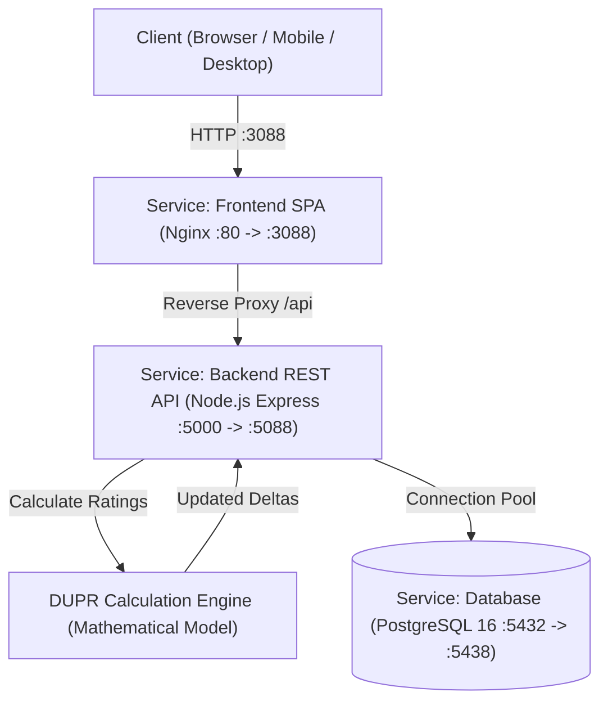

# XGame Sports Platform (Pickleball & Badminton DUPR Engine)

Hệ thống quản lý câu lạc bộ thể thao chuyên nghiệp với công thức chuẩn **DUPR Rating**, lưu trữ **PostgreSQL**, kiến trúc **Service-Oriented** và đóng gói hoàn chỉnh bằng **Docker & Docker Compose**.

---

## 🏛️ Kiến Trúc Hệ Thống (Architecture & Services)

Hệ thống được module hóa thành các Service độc lập, giao tiếp qua REST API và mạng nội bộ Docker:



### 1. `database` (PostgreSQL 16)
- **Database Name**: `xgame_db`
- **Port Host**: `5438` (Container: `5432` - Đã đổi tránh xung đột cổng PostgreSQL mặc định trên server)
- **Tables**:
  - `clubs`: Lưu thông tin các CLB (`c-pickleball`, `c-badminton`,...).
  - `users`: Tài khoản thành viên với xác thực bảo mật **Email + Password (Bcrypt Hash)** và JWT Token.
  - `players`: Hồ sơ vận động viên, điểm DUPR Đôi/Đơn, số trận, tỉ lệ thắng, chuỗi thắng/thua, form 5 trận gần nhất.
  - `matches`: Lịch sử các trận đấu, điểm số từng set, tỉ lệ thắng kỳ vọng, điểm chênh lệch và lịch sử thay đổi rating.
- **Tự động khởi tạo**: File [server/db/init.sql](file:///d:/XGame/xgame_pickleball/server/db/init.sql) tự động tạo bảng, thiết lập Index hiệu năng cao và nạp sẵn dữ liệu mẫu cho cả 2 CLB: **XGame Pickleball** và **XGame Badminton**.

### 2. `backend` (Node.js Express Service)
- **Port Host**: `5088` (Container: `5000`)
- **Cấu trúc Thư mục**:
  - `src/config/db.js`: Quản lý PostgreSQL Connection Pool (`pg`).
  - `src/services/duprEngine.js`: Thuật toán tính điểm DUPR chuẩn (logistic curve, margin of victory, half-life weighting).
  - `src/controllers/`: Bộ điều khiển phân tách chuyên nghiệp:
    - `clubController.js`: Lấy danh sách CLB, chuyển đổi CLB.
    - `playerController.js`: Lấy danh sách VĐV, lọc theo CLB, bảng xếp hạng DUPR.
    - `matchController.js`: Ghi nhận trận đấu trong Transaction, tự động cập nhật DUPR cho cả 4 VĐV.
    - `authController.js`: Đăng ký, đăng nhập chuẩn Email + Mật khẩu với JWT.
  - `src/routes/api.js`: Tổng hợp các endpoint RESTful chuẩn.
  - `src/middleware/auth.js`: Xác thực JWT Bearer Token.

### 3. `frontend` (React + TypeScript + Vite + Nginx)
- **Port Host**: `3088` (Container: `80`)
- **Web Server**: Nginx Alpine siêu nhẹ, tối ưu nén Gzip, cache static files và Reverse Proxy toàn bộ `/api` về `backend:5000`.
- **UI & Components**:
  - Đầy đủ 2 chế độ hiển thị: **Desktop Dashboard** & **Mobile App View**.
  - Dropdown chuyển đổi mượt mà giữa **XGame Pickleball** và **XGame Badminton**.
  - Tính năng **Bảng Xếp Hạng CLB**, **Hồ sơ VĐV**, **Ghi nhận trận đấu trực tiếp**, **DUPR Calculator**, **Bảng điểm sân đấu**.
  - Đăng nhập/Đăng ký chuẩn bằng **Email + Mật khẩu**.

---

## 🚀 Hướng Dẫn Khởi Chạy (Deployment Guide)

### Cách 1: Khởi Chạy Nhanh Bằng Docker Compose (Khuyên Dùng)

Chỉ cần 1 câu lệnh duy nhất tại thư mục gốc:

```bash
docker compose up --build -d
```

Sau khi khởi chạy thành công:
- 🌐 **Frontend Web App**: [http://localhost:3088](http://localhost:3088)
- 🔌 **Backend REST API**: [http://localhost:5088/api](http://localhost:5088/api)
- 🏥 **API Health Check**: [http://localhost:5088/api/health](http://localhost:5088/api/health)
- 🗄️ **PostgreSQL Port**: `localhost:5438`

Để xem logs của toàn bộ hệ thống:
```bash
docker compose logs -f
```

Để dừng hệ thống:
```bash
docker compose down
```

---

### Cách 2: Chạy Môi Trường Phát Triển Thủ Công (Local Dev)

#### 1. Khởi động Backend:
```bash
cd server
npm install
npm run dev
```

#### 2. Khởi động Frontend:
```bash
# Tại thư mục gốc xgame_pickleball
npm install
npm run dev
```
Truy cập Frontend Vite tại: [http://localhost:5173](http://localhost:5173)

---

## 🔐 Tài Khoản Đăng Nhập Mẫu

Bạn có thể đăng ký tài khoản mới bằng Email bất kỳ hoặc sử dụng các tài khoản có sẵn trong hệ thống:
- **Email**: `nguyen.anh@xgame.vn` | **Mật khẩu**: `pickleball2026`
- **Email**: `tran.binh@xgame.vn` | **Mật khẩu**: `pickleball2026`
- **Email**: `le.cuong@xgame.vn` | **Mật khẩu**: `pickleball2026`
